<picture><source media="(prefers-color-scheme: light)" srcset="assets/hero-light.svg"></picture>

<picture><source media="(prefers-color-scheme: light)" srcset="assets/h-now-light.svg"></picture>

<picture><source media="(prefers-color-scheme: light)" srcset="assets/now-light.svg">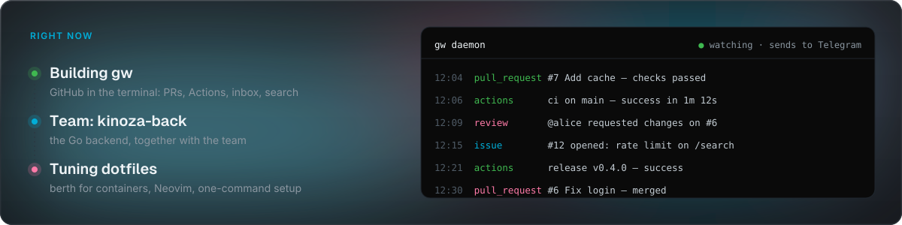</picture>

<picture><source media="(prefers-color-scheme: light)" srcset="assets/h-about-light.svg"></picture>

- Go backend developer in Saint Petersburg
- REST services with Gin, PostgreSQL, Redis and Docker: tested, linted and shipped through CI on every push
- Building [gw](https://github.com/van1dalgrr-arch/github-watcher), GitHub in the terminal with a daemon that sends alerts to Telegram
- In a team: the Go backend of [kinoza-back](https://github.com/orionvega2343-cloud/kinoza-back)
- Also comfortable with Java and Spring Boot
- My macOS setup is open source: [dotfiles](https://github.com/van1dalgrr-arch/dotfiles), with [berth](https://github.com/van1dalgrr-arch/dotfiles/tree/main/berth) for containers in the terminal

<picture><source media="(prefers-color-scheme: light)" srcset="assets/h-projects-light.svg">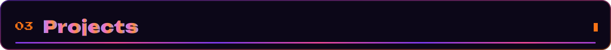</picture>

<a href="https://github.com/van1dalgrr-arch/github-watcher"><picture><source media="(prefers-color-scheme: light)" srcset="assets/featured-light.svg"></picture></a>

  <a href="https://github.com/orionvega2343-cloud/kinoza-back"><picture><source media="(prefers-color-scheme: light)" srcset="assets/p-kinoza-light.svg">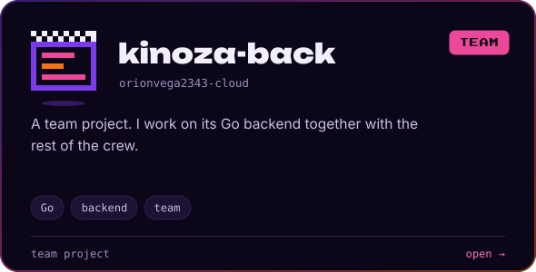</picture></a>
  <a href="https://github.com/van1dalgrr-arch/logsence"><picture><source media="(prefers-color-scheme: light)" srcset="assets/p-logsence-light.svg">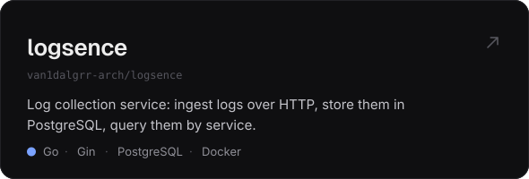</picture></a>

  <a href="https://github.com/van1dalgrr-arch/dotfiles"><picture><source media="(prefers-color-scheme: light)" srcset="assets/p-dotfiles-light.svg">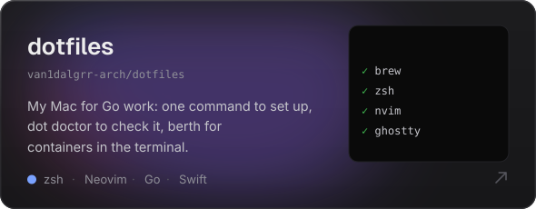</picture></a>
  <a href="https://github.com/van1dalgrr-arch/Pulse"><picture><source media="(prefers-color-scheme: light)" srcset="assets/p-pulse-light.svg">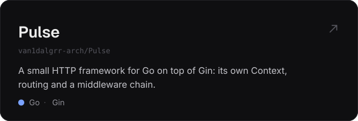</picture></a>

  <a href="https://github.com/van1dalgrr-arch/watchdog"><picture><source media="(prefers-color-scheme: light)" srcset="assets/p-watchdog-light.svg">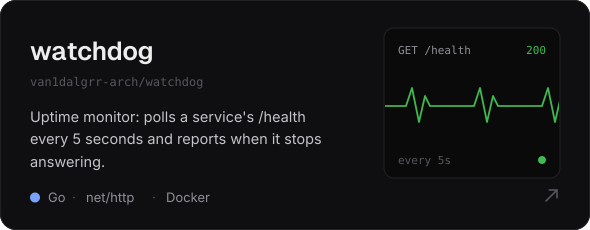</picture></a>
  <a href="https://github.com/van1dalgrr-arch/OrderGo"><picture><source media="(prefers-color-scheme: light)" srcset="assets/p-ordergo-light.svg">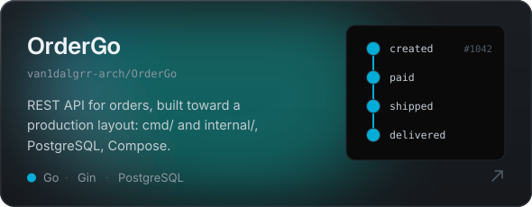</picture></a>

<a href="https://github.com/van1dalgrr-arch/logsence"><picture><source media="(prefers-color-scheme: light)" srcset="assets/flow-light.svg">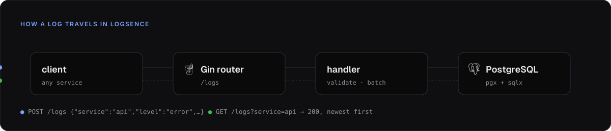</picture></a>

<picture><source media="(prefers-color-scheme: light)" srcset="assets/h-journey-light.svg"></picture>

<picture><source media="(prefers-color-scheme: light)" srcset="assets/journey-light.svg"></picture>

<picture><source media="(prefers-color-scheme: light)" srcset="assets/h-ship-light.svg"></picture>

<picture><source media="(prefers-color-scheme: light)" srcset="assets/ci-light.svg">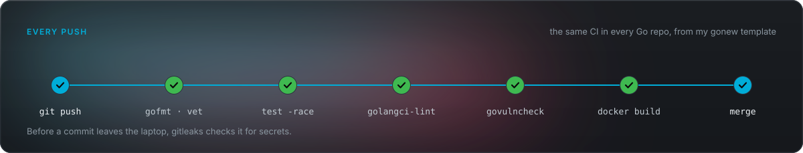</picture>

<picture><source media="(prefers-color-scheme: light)" srcset="assets/h-habits-light.svg"></picture>

<picture><source media="(prefers-color-scheme: light)" srcset="assets/habits-light.svg"></picture>

<picture><source media="(prefers-color-scheme: light)" srcset="assets/h-stack-light.svg"></picture>

<picture><source media="(prefers-color-scheme: light)" srcset="assets/stack-light.svg"></picture>

<picture><source media="(prefers-color-scheme: light)" srcset="assets/h-activity-light.svg">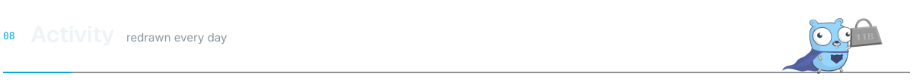</picture>

<picture><source media="(prefers-color-scheme: light)" srcset="https://raw.githubusercontent.com/van1dalgrr-arch/van1dalgrr-arch/output/scores-light.svg"></picture>

<picture><source media="(prefers-color-scheme: light)" srcset="https://raw.githubusercontent.com/van1dalgrr-arch/van1dalgrr-arch/output/calendar-light.svg"></picture>

<picture><source media="(prefers-color-scheme: light)" srcset="assets/h-contact-light.svg">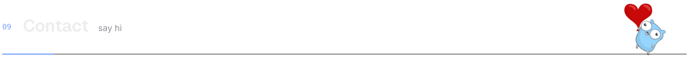</picture>

[van1dalgrr@gmail.com](mailto:van1dalgrr@gmail.com) · [github.com/van1dalgrr-arch](https://github.com/van1dalgrr-arch) · English or Russian

<picture><source media="(prefers-color-scheme: light)" srcset="assets/footer-light.svg">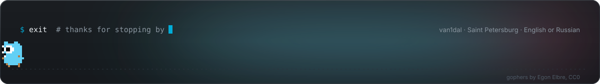</picture>

The images are drawn by [`scripts/build.py`](scripts/build.py); activity is redrawn daily by [a workflow](.github/workflows/graphics.yml).
