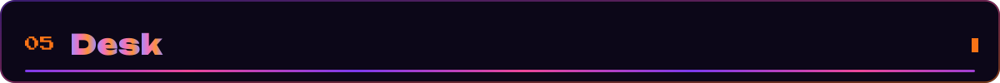
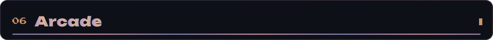

- 🌆 **Go backend developer** from Saint Petersburg
- 🛠️ I build **REST services** with Gin, PostgreSQL, Redis and Docker: tested, linted and shipped through **CI on every push**
- 🔭 Right now: [**gw**](https://github.com/van1dalgrr-arch/github-watcher), GitHub in the terminal, with a daemon that pings my phone through Telegram
- 🤝 In a team: the Go backend of [kinoza-back](https://github.com/orionvega2343-cloud/kinoza-back)
- ☕ Also at home in **Java / Spring Boot**
- 🖥️ My whole macOS setup is open source: [dotfiles](https://github.com/van1dalgrr-arch/dotfiles), with [berth](https://github.com/van1dalgrr-arch/dotfiles/tree/main/berth), containers in the terminal

  
  

  
  

  
  

A MacBook Air with 8 GB: Ghostty, AeroSpace, Neovim, OrbStack. One command sets it all up, <code>dot doctor</code> checks it.

<b>🕹️ two more cabinets: Breakout, Galaga and a 3D city of commits</b>

 

  
  
  

  
  
  

Every picture here is drawn by code in this repo: [`scripts/build.py`](scripts/build.py) for the static ones,
[`terminal.py`](scripts/terminal.py) and [`stats.py`](scripts/stats.py) for the live ones, redrawn daily by [a workflow](.github/workflows/graphics.yml).
